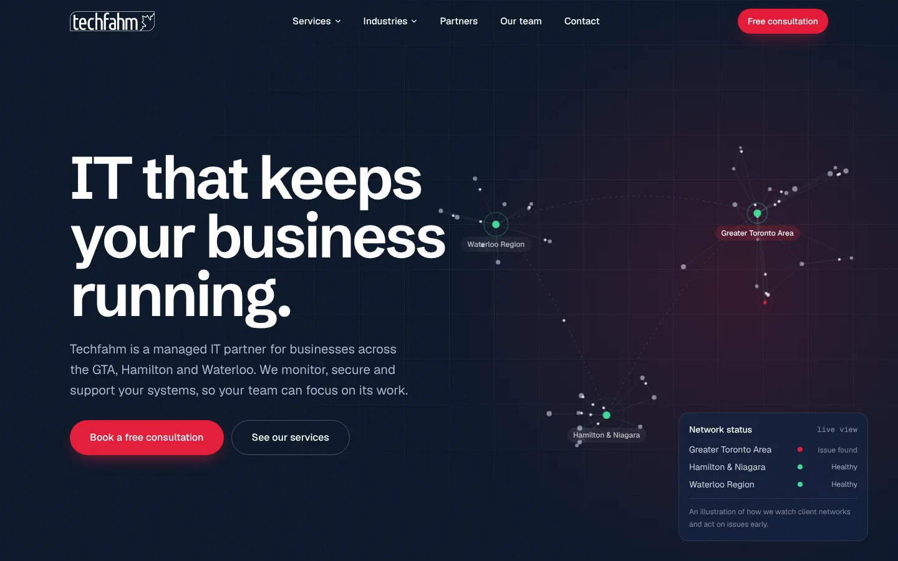
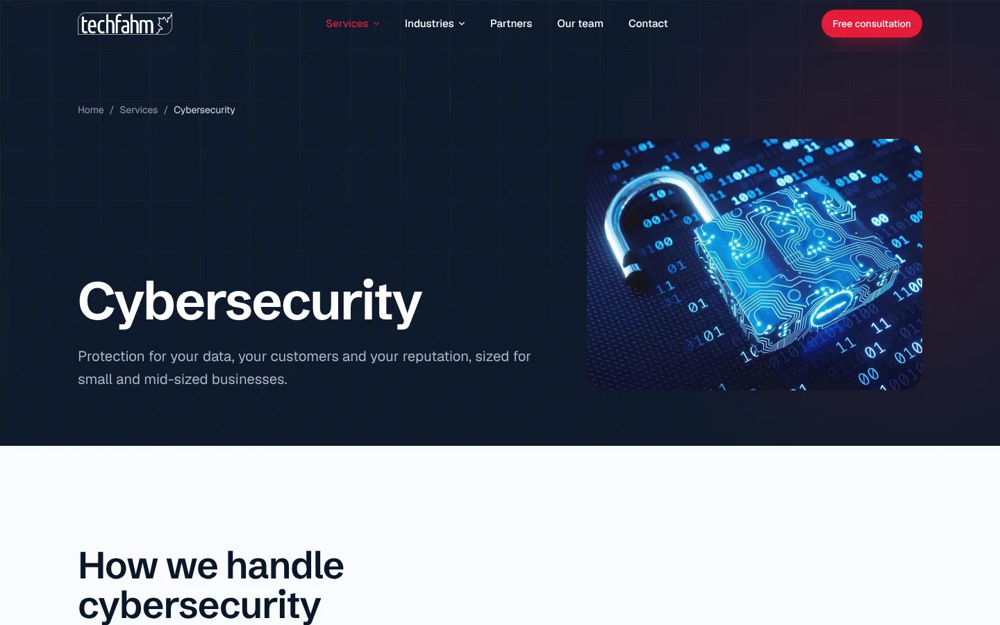

# Techfahm.com — website redesign

A fast, mobile-first rebuild of [techfahm.com](https://techfahm.com) (previously WordPress) for **Techfahm Systems Inc.**, a managed IT services provider serving the Greater Toronto Area, Hamilton & Niagara and the Waterloo Region.

**Live preview:** https://miladmo68.github.io/Techfahm/  
**Designed & developed by [Milink](https://milink.ca)**



## Highlights

- **Static Next.js site.** Exports plain HTML/CSS/JS that runs on any cPanel host, with no Node or PHP on the server.
- **Signature hero.** A canvas network map of the three service regions, with data packets moving along the links and an alert that gets raised and then resolved.
- **Motion:** smooth scroll (Lenis), masked headline reveals, sticky stacked service panels, scroll-filled statement, parallax and clip-path image reveals, magnetic buttons, custom cursor, page transitions, and a full-screen mobile menu. Every animation respects `prefers-reduced-motion`.
- **Mobile-first.** Tested at 390px and 1440px, with no horizontal overflow and 44px tap targets.
- **SEO:**
  - per-page titles, descriptions and canonicals
  - branded Open Graph image for every page
  - JSON-LD for Organization, Service, FAQPage and BreadcrumbList
  - sitemap.xml that includes images
  - robots.txt, `llms.txt`, and local landing pages for Toronto, Hamilton and Waterloo
  - the same URLs as the old WordPress site
- **Security** (`.htaccess`): HTTPS + HSTS, strict Content-Security-Policy, clickjacking and MIME-sniffing protection, a locked-down Permissions-Policy, blocked access to dotfiles and backups, old WordPress attack paths returned as 410 Gone, and `security.txt`. The contact form has honeypot and timing checks.
- **Images.** Every image is downloaded into the project and optimised to WebP at five widths, then served through `next/image` with a custom loader. No hotlinking.

| Services (sticky stack) | Service page |
|---|---|
|  |  |

| Mobile hero | Mobile menu | Local landing page |
|---|---|---|
|  |  |  |

| Industries | Generated share image |
|---|---|
|  |  |

## Tech stack

Next.js 16 (App Router, static export) · React 19 · TypeScript · Tailwind CSS v4 · Motion · Lenis · Radix UI · React Hook Form + Zod · sharp · Schibsted Grotesk + Geist

## Pages

`/` · `/services/` + 6 service pages · `/industry/` + Health, Manufacturing & Distribution · `/managed-it-services-toronto/` · `/managed-it-services-hamilton/` · `/managed-it-services-waterloo/` · `/partners/` · `/our-team/` · `/contact/` · `404`

## Run it locally

```bash
npm install
npm run images     # downloads and optimises all images (already included in the repo)
npm run dev        # http://localhost:3000
```

Copy `.env.example` to `.env.local` and fill in what you need:

| Variable | What it's for |
|---|---|
| `NEXT_PUBLIC_WEB3FORMS_KEY` | Free key from [web3forms.com](https://web3forms.com). Without it, the form opens the visitor's email app instead. |
| `NEXT_PUBLIC_GOOGLE_SITE_VERIFICATION` | Google Search Console HTML-tag code |
| `NEXT_PUBLIC_BING_SITE_VERIFICATION` | Bing Webmaster Tools code |

## Deploy to cPanel (techfahm.com)

1. **Back up the WordPress site** (cPanel → Backup Wizard), then move the old files out of `public_html`. Removing WordPress from the server is the single biggest security improvement.
2. Run `npm run build`, then `cd out && zip -r ../techfahm-site.zip . && cd ..`
3. In cPanel → File Manager → `public_html`, upload and extract `techfahm-site.zip`. Turn on *Show Hidden Files* and check that `.htaccess` and `.well-known/` are there.
4. Check https://techfahm.com, then test the headers at [securityheaders.com](https://securityheaders.com) and the tags at [Google's Rich Results Test](https://search.google.com/test/rich-results).
5. In [Google Search Console](https://search.google.com/search-console) and [Bing Webmaster Tools](https://www.bing.com/webmasters), verify the site and submit `https://techfahm.com/sitemap.xml`.

## Working on the project

Every decision, the design tokens, the file map and the change log are in [`docs/CONTEXT.md`](docs/CONTEXT.md). AI assistants should read [`CLAUDE.md`](CLAUDE.md) first. All copy lives in `src/content/`.

The GitHub Pages preview is built by [`.github/workflows/pages.yml`](.github/workflows/pages.yml) under `/Techfahm` and is marked `noindex`, so it never competes with techfahm.com in search.

---

© Techfahm Systems Inc. · Website by [Milink](https://milink.ca)
